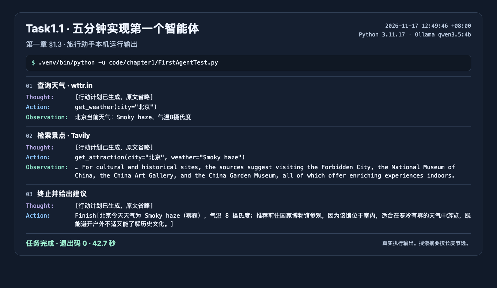

# Task1.1 学习笔记 · 第一章 初识智能体

## 1.1 到 1.2 的概念

智能体围绕目标感知环境、选择行动，再根据行动结果决定下一步。分析类型时可以分别考察行动依据、对响应速度的要求和知识如何表示。一个数字孪生抓取系统可以由规则表达关节约束，由学习模型估计物体状态，再用规划模块评估候选路径。这三个特征分别回答了不同层面的问题。[第一章原文](https://github.com/datawhalechina/hello-agents/tree/main/docs/chapter1) · [课程在线阅读](https://hello-agents.datawhale.cc/)

| PEAS | 本次旅行助手 |
| --- | --- |
| P · 性能度量 | 查到北京当前天气，挑出一个适合的景点，给出能由两次观察支持的理由。 |
| E · 环境 | 北京的实时天气、网络上的景点信息，以及用户的要求。天气和搜索索引都可能变化，程序只能读取接口返回的部分信息。 |
| A · 执行器 | Python 工具发出天气请求和景点查询，程序输出最终建议。 |
| S · 传感器 | 用户输入，以及天气和搜索服务的响应。 |

`Thought` 在教学日志里表示模型给出的行动说明，`Action` 是可由程序解析的请求，`Observation` 是 Python 执行工具后得到的反馈。代码把每轮输出和观察追加到 `prompt_history` 中，后续的搜索参数可以直接使用天气描述。这个示例按模型的文本选择工具，`available_tools` 确定了程序能够实际执行的动作，`Finish[...]` 是结束协议。[1.2 智能体的构成与运行原理](https://github.com/datawhalechina/hello-agents/blob/main/docs/chapter1/%E7%AC%AC%E4%B8%80%E7%AB%A0%20%E5%88%9D%E8%AF%86%E6%99%BA%E8%83%BD%E4%BD%93.md#12-智能体的构成与运行原理)

## 1.3 实操

1. 在 Task1 的项目目录使用已有 `.venv`，用 `pip check` 检查依赖。继续使用 Task1 的 `.env`、本机 Ollama `qwen3.5:4b`、wttr.in 和 Tavily。
2. 启动第一章脚本。依次检查天气工具返回有效天气和温度、景点工具收到原样天气描述并返回候选、模型进入 `Finish`、进程正常退出。
3. 将真实进程输出整理为截图。截图保留工具名、实际参数、观察结果和退出码，省略模型的行动说明原文并节选搜索摘要。

```bash
.venv/bin/python --version
.venv/bin/python -m pip check
.venv/bin/python -u code/chapter1/FirstAgentTest.py
```

### 踩坑与修复

首跑时，模型把通用模板中的 `function_name=` 当作字面前缀，连续五轮生成 `Action: function_name=get_weather(city="北京")`。脚本的 Action 解析器只接受从工具名开始的调用，这些 Action 没有触发网络查询，脚本达到五轮上限后以 `1` 退出。

我把提示词中抽象的调用格式换成具体的命名参数示例，明确 Action 从工具名开始，并要求在景点查询里原样使用天气描述。两次工具调用随后都成功了，但模型把 `Finish[...]` 的回答分成几行，原先只取 Action 首行，读不到闭合括号。本版让 `Finish` 读取括号内的完整文本，工具调用仍按单行解析。用模拟模型输出分别检查单行和跨行 `Finish` 后，再执行真实工具联调。排查时先确认动作有没有被解析，再看实际工具回包。[本项目示例代码](../../code/chapter1/FirstAgentTest.py)

### 实际运行与截图

运行于 2026-11-17 12:49:46（北京时间），总耗时 42.7 秒。实测依次出现三轮 `Thought` 和 `Action`，前两轮返回有效 `Observation`，最后一轮执行 `Finish`，进程退出码为 `0`。

| 轮次 | 实际 Action | 观察或结束结果 |
| --- | --- | --- |
| 1 | `get_weather(city="北京")` | wttr.in 返回 `Smoky haze`（雾霾）、8°C。 |
| 2 | `get_attraction(city="北京", weather="Smoky haze")` | Tavily 返回中国国家博物馆、北京海洋馆等室内候选。 |
| 3 | `Finish[...]` | 保留当次天气和气温，推荐国家博物馆。 |

[查看完整截图](task1.1-run.png)



## 习题和视频

- [第一章六道习题解答](exercises.md)。第 4 题提交旅行助手扩展设计，第 5 题提交机械臂数字孪生的快慢系统方案。
- 本次短视频根据同一次真实运行制作，依次讲解天气观察、天气参数怎样进入搜索、以及 `Finish` 怎样结束循环。[Task1.1 中文操作演示 MP4](https://github.com/XINTIANYUAN/hello_agents/releases/download/v1.1/task1.1-demo.mp4)
- 官方共创索引尚未列出第一章。社区视频《HelloAgents 第一讲》的公开视频简介覆盖 Agent 与 ReAct、模型采样基础和旅行助手代码。对照视频时可以关注工具组织和观察回填的共同点，视频用 DeepSeek API，本次用同样兼容 Chat Completions 的本地模型接口。[官方视频索引](https://github.com/datawhalechina/hello-agents/blob/main/Extra-Chapter/Extra13-Hello-Agents%E8%A7%86%E9%A2%91%E8%AF%BE%E5%BD%95%E5%88%B6%E5%85%B1%E5%88%9B.md) · [社区实战视频](https://www.bilibili.com/video/BV1UArsBQEWV/)

[Task1.1 学习心得](reflections.md) · [Task1.1 课程内容反馈](course-feedback.md)
