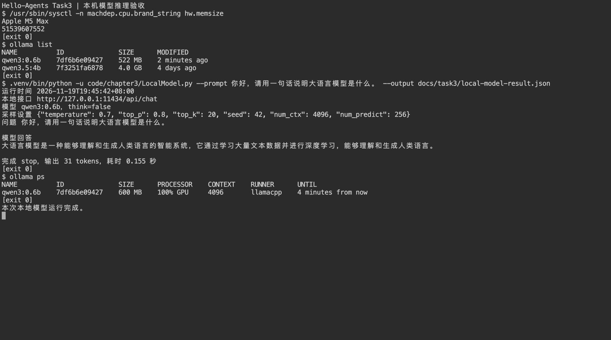

# Task3 学习笔记 · 第三章 大语言模型基础

## 从概率模型到生成

Bigram 根据前一个词估计下一个词的概率。小语料上的计数容易核对，未出现的组合则暴露出稀疏问题。RNN 用隐状态聚合历史，Transformer 用注意力在可见范围内建立位置间的联系。因果掩码使某一位置的预测只能利用该位置之前的信息。训练时已知序列可以并行计算损失，生成时仍逐个 token 延长回答。[第三章原文](https://github.com/datawhalechina/hello-agents/blob/2eb1c7547018b519b85cb57acf5533f12d65bf8e/docs/chapter3/%E7%AC%AC%E4%B8%89%E7%AB%A0%20%E5%A4%A7%E8%AF%AD%E8%A8%80%E6%A8%A1%E5%9E%8B%E5%9F%BA%E7%A1%80.md)

分词决定文本怎样转成模型输入。BPE 把频繁相邻单元合并，使常见片段能够复用。实际模型还需要自己的对话模板，让不同角色的内容落到正确位置。采样随后从词元概率分布中选择输出，温度和候选裁剪参数会影响多样性、格式和任务结果。[课程 §3.2](https://github.com/datawhalechina/hello-agents/blob/2eb1c7547018b519b85cb57acf5533f12d65bf8e/docs/chapter3/%E7%AC%AC%E4%B8%89%E7%AB%A0%20%E5%A4%A7%E8%AF%AD%E8%A8%80%E6%A8%A1%E5%9E%8B%E5%9F%BA%E7%A1%80.md#32-与大语言模型交互)

## 硬件检查和部署选择

本机是 Apple M5 Max MacBook Pro，配备 48 GB 统一内存。既有环境是 Python 3.11.17 和 Ollama 0.40.16。正文 §3.2.3 使用 Transformers 加载 Qwen1.5-0.5B-Chat，习题 4 推荐 Qwen3-0.6B。本次选用习题推荐模型的 Ollama 包，复用已安装的本地推理服务。模型缓存和本次 GPU 加载量远低于本机物理内存。[模型官方说明](https://huggingface.co/Qwen/Qwen3-0.6B) · [Ollama 模型页](https://ollama.com/library/qwen3:0.6b)

| 项目 | 本次实测 |
| --- | --- |
| 模型名称 | `qwen3:0.6b` |
| 模型摘要 | `7df6b6e09427`，完整 digest 在部署记录中 |
| 量化 | Q4_K_M |
| 下载后的模型包大小 | 522,653,767 字节 |
| Ollama 报告的模型加载量 | 600,016,157 字节，约 600 MB |
| 推理放置 | `ollama ps` 显示 `100% GPU`，运行器 `llamacpp` |
| 本次上下文设置 | 4096 tokens |
| 思考模式 | `think=false`，记录最终回答 |

加载量是 Ollama 报告的该模型数据，整机和其他进程仍会占用内存。模型包的参数量标签与实际文件大小也应分别记录。[本机部署元信息](deployment.json)

## 本机运行过程

先检查已有服务与模型，再从 Ollama 官方模型库下载，使用项目已有解释器执行本地推理。代码只使用 Python 标准库，请求发往 `127.0.0.1`。模型权重保存在本机 Ollama 缓存中。

```bash
ollama --version
ollama list
ollama pull qwen3:0.6b
.venv/bin/python -u code/chapter3/LocalModel.py
ollama ps
```

2026 年 11 月 19 日，本地模型实际回答了「你好，请用一句话说明大语言模型是什么。」。本次回答为「大语言模型是一种能够理解和生成人类语言的智能系统，它通过学习大量文本数据并进行深度学习，能够理解和生成人类语言。」生成了 31 个 token，结束原因为 `stop`，进程退出码为 `0`，热启动单次请求耗时 0.155 秒。模型回答原样保存在 JSON 和完整终端日志中。[推理代码](../../code/chapter3/LocalModel.py) · [本次请求与回答](local-model-result.json) · [完整终端输出](local-model-terminal.txt)

截图使用本机 ttyd 的只读 PTY 终端，连接实际运行进程。截图显示硬件、模型列表、完整生成命令、模型回答、退出码及 GPU 加载状态。为此通过 Homebrew 安装了 ttyd，取图后已结束该次终端服务。



## 概率与分词代码

课程的 `N_gram.py` 和 `BPE.py` 直接使用上游版本，在本机原虚拟环境中运行。

```bash
.venv/bin/python code/chapter3/N_gram.py
.venv/bin/python code/chapter3/BPE.py
```

前者输出 `P(datawhale agent learns) ≈ 0.167`。沿用同样的首词计数约定，习题的 `agent works` 也是 `(2/6)×(1/2)=1/6`。BPE 依次合并 `u+g`、`ug+</w>`、`u+n`、`un+</w>`。两段程序均以 `0` 退出。[N-gram 代码](../../code/chapter3/N_gram.py) · [BPE 代码](../../code/chapter3/BPE.py)

## 采样与提示实验

```bash
.venv/bin/python code/chapter3/Experiments.py
```

采样实验在同一命名任务上比较两组温度和候选范围，每组使用三个种子。较低一组在三次回答中都给出「张三、李四、王五」，较高一组得到三种回答，并在两次回答中使用了列表，偏离顿号分隔要求。这里同时改变了温度、top-p 和 top-k，观察的是联合配置差异。[采样原始记录](sampling-results.json)

| 提示方式 | 电商反馈标签匹配 | 平均输入 tokens | 平均输出 tokens |
| --- | --- | --- | --- |
| Zero-shot | 4/4 | 65 | 36 |
| Few-shot | 4/4 | 136 | 32 |
| 分步检查提示 | 4/4 | 88 | 48.5 |

三种提示固定模型、采样设置和四条待测反馈。输出都带 Markdown 围栏，程序先取出 JSON 再核对标签。分步检查组有三次重复了 `reason` 键。这个结果说明需要分别检查分类、依据和 JSON 格式。四条样本的相同标签结果，只能支持本次样本上的比较。[完整提示与输出](prompt-results.json) · [习题 4 分析](exercises.md#4-本地模型实践提示策略与模型选型)

## 踩坑和心得

- **正文与习题用了不同模型。** 模型升级同时涉及架构支持、对话模板和生成设置。本次用习题推荐的 Qwen3，并用 Ollama 处理量化权重和模板加载。原文的 Transformers 步骤可用于理解 token 化、生成和解码的层次。[课程 §3.2.3](https://github.com/datawhalechina/hello-agents/blob/2eb1c7547018b519b85cb57acf5533f12d65bf8e/docs/chapter3/%E7%AC%AC%E4%B8%89%E7%AB%A0%20%E5%A4%A7%E8%AF%AD%E8%A8%80%E6%A8%A1%E5%9E%8B%E5%9F%BA%E7%A1%80.md#323-调用开源大语言模型)
- **生成速度受加载和缓存影响。** 第一次介绍自身的请求耗时 1.254 秒，截图中的短问题热启动为 0.155 秒。两条提示和输出长度不同，实测耗时适合作为该次记录。比较吞吐还需要固定负载、重复测量。[本次运行设置](local-model-result.json)
- **标签正确还需核对理由与结构。** 常规 JSON 解析会接受重复键并保留最后一个值，标签正确数容易遮住问题。原始回答保留以后，可以增加重复键、字段唯一性和来源支持的检查。
- **已有任务的复核。** 本次变更新增第三章代码与学习材料，原虚拟环境通过 `pip check`。发布前核对第一、二章代码、依赖和前期文档相对 `v1.2` 的差异。

## 视频学习记录

官方视频共创索引暂未列出第三章。本次选读了社区第三章导读的作者说明，并核看公开关键帧和画面内嵌字幕。以下时间点用于回看对应片段。[官方视频索引](https://github.com/datawhalechina/hello-agents/blob/main/Extra-Chapter/Extra13-Hello-Agents%E8%A7%86%E9%A2%91%E8%AF%BE%E5%BD%95%E5%88%B6%E5%85%B1%E5%88%9B.md) · [社区第三章导读](https://www.youtube.com/watch?v=S3KMSjIY7sw)

- **约 02:24–02:55 的注意力示意。** 页面用一句包含 `it` 的英文展示词间联系。对照课文可把注意力权重理解为当前表示如何读取其他可见位置的信息。[对应片段](https://www.youtube.com/watch?v=S3KMSjIY7sw&t=144s)
- **约 06:29 的 BPE 演示。** 页面把中英文文本分成不同颜色的 token 片段。本机小例子则展示相邻单元合并的四个步骤。模型实际分词需使用该模型自己的词表。[对应片段](https://www.youtube.com/watch?v=S3KMSjIY7sw&t=389s)
- **约 08:19–09:05 的本地部署。** 页面转入 Ollama 终端，画面先出现模型下载进度，再出现生成回答。本次在同一路径上补记了硬件、模型 digest、量化、采样选项和退出码，便于复现。[对应片段](https://www.youtube.com/watch?v=S3KMSjIY7sw&t=499s)

[第三章六道习题解答](exercises.md) · [中文学习心得](reflections.md) · [中文课程反馈](course-feedback.md)
