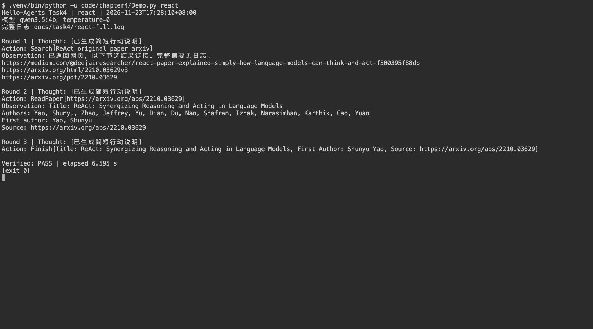
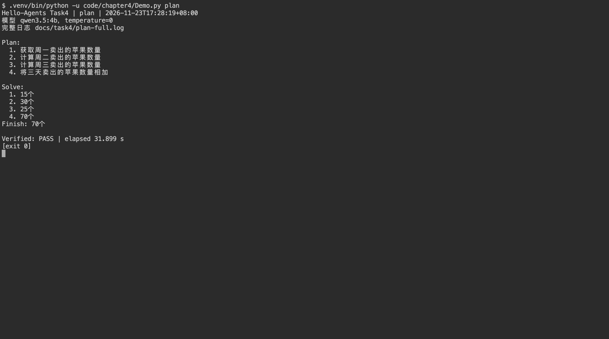
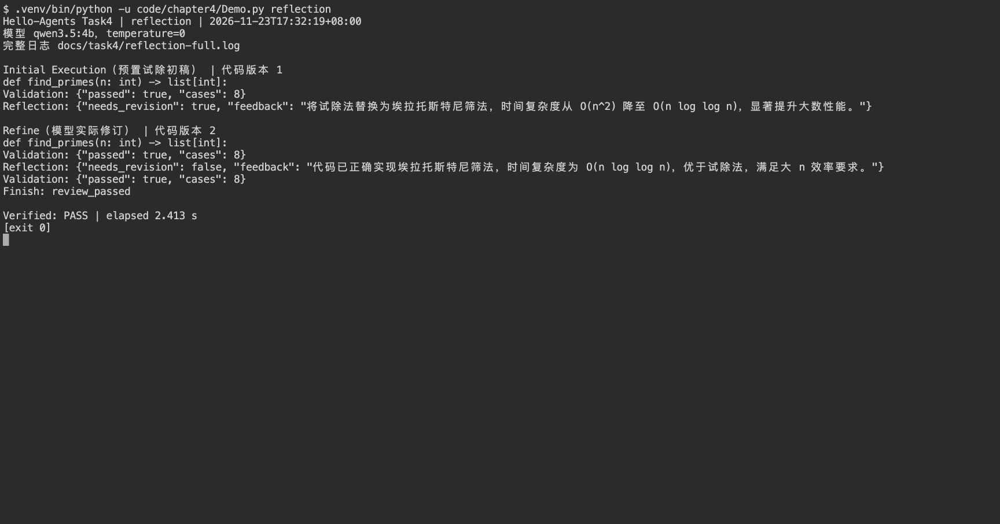

# Task4 学习笔记 · 第四章 智能体经典范式构建

## 三种循环怎样组织任务

| 范式 | 本次观察的状态传递 | 结束依据 |
| --- | --- | --- |
| ReAct | 模型选择一个工具，实际工具结果作为 Observation 进入下一轮。 | 取得所需观察后输出 Finish，另外设置最大轮次。 |
| Plan-and-Solve | 模型先列出步骤，执行器把每步结果交给后续步骤。 | 按顺序完成全部计划，再给最终答案。 |
| Reflection | 生成初稿，评审给出反馈，执行器据此修订，再做检查。 | 结构化评审通过且函数用例通过，或达到迭代上限后完成验证。 |

这三种组织方式决定了错误反馈会在什么时机被使用。搜索结果不相关时，ReAct 可以下一轮重新检索。应用题先规划更容易追踪数据依赖。代码优化还要回头检查上一版，并验证新代码是否保留原来的行为。[第四章原文](https://github.com/datawhalechina/hello-agents/blob/2eb1c7547018b519b85cb57acf5533f12d65bf8e/docs/chapter4/%E7%AC%AC%E5%9B%9B%E7%AB%A0%20%E6%99%BA%E8%83%BD%E4%BD%93%E7%BB%8F%E5%85%B8%E8%8C%83%E5%BC%8F%E6%9E%84%E5%BB%BA.md) · [国内在线阅读](https://hello-agents.datawhale.cc/)

## 环境和本机运行

沿用项目的 Python 3.11.17 虚拟环境、现有 OpenAI SDK、requests、python-dotenv 和 Tavily 客户端。模型继续使用本机 Ollama 的 `qwen3.5:4b`，温度为 0。共享客户端可读取第四章的 `LLM_*` 变量，也可读取 Task1 已有的 `OPENAI_API_KEY`、`OPENAI_BASE_URL`、`MODEL_NAME`。

课程搜索示例使用 SerpApi。本次复用已有 Tavily 配置，并增加读取 arXiv 论文元数据的 ReadPaper 工具。三个范式的入口保留在 `code/chapter4/`。第一、二、三章的代码和依赖与 `v1.3` 进行了逐项比较，已有虚拟环境通过 `pip check`。

```bash
.venv/bin/python -m pip check
.venv/bin/python code/chapter4/ReAct.py
.venv/bin/python code/chapter4/Plan_and_solve.py
.venv/bin/python code/chapter4/Reflection.py
```

需要重现本次验收和保存完整日志时，可运行下面的命令。程序会实际调用模型，核对关键结果，再打印可截图的循环摘要。网络搜索结果和模型措辞可能随运行变化。

```bash
.venv/bin/python -u code/chapter4/Demo.py react
.venv/bin/python -u code/chapter4/Demo.py plan
.venv/bin/python -u code/chapter4/Demo.py reflection
```

## 实际运行与截图

截图在本机 ttyd 的只读 PTY 终端中取得，显示验收脚本的实际输出与退出码。Search 的长摘要在终端摘要中节选为链接，完整内容保存在日志。模型的行动说明原文省略，保留 Thought 标记和实际 Action、Observation。

### ReAct

实际经过 Search → ReadPaper → Finish。搜索返回 ReAct 论文的页面，读取原页面后得到标题 `ReAct: Synergizing Reasoning and Acting in Language Models`、第一作者 `Yao, Shunyu` 和 arXiv 链接。程序检查工具观察成功，并核对最终回答包含该作者和论文编号。[完整执行日志](react-full.log) · [结构化结果](react-result.json) · [终端文本](react-terminal.txt)



### Plan-and-Solve

模型先生成四步计划。执行器分别得到周一 15 个、周二 30 个、周三 25 个，最后汇总为 70 个。程序检查全部计划都有执行结果，并核对最终答案。[完整执行日志](plan-full.log) · [结构化结果](plan-result.json) · [终端文本](plan-terminal.txt)



### Reflection

为了展示完整的修订过程，截图演示使用与角色对照实验相同的预置试除初稿，让模型实际评审并优化为埃拉托斯特尼筛法。生成的函数在独立进程中验证，输入包括负数、0、1、2、3、10、30 和 100，并额外检查重复调用。评审使用明确的 `needs_revision` 字段，只有评审通过并且函数验证通过才提前结束。[完整执行日志](reflection-full.log) · [结构化结果](reflection-result.json) · [终端文本](reflection-terminal.txt)



## 习题实践与观察

```bash
.venv/bin/python code/chapter4/Experiments.py
.venv/bin/python code/chapter4/ReAct.py --format json --question '请用计算器求 (123+456)*789/12 的结果。'
```

- **动作解析。** 固定输入各 10 个案例，文本协议有 9 个符合预期，JSON 有 10 个。对照覆盖多行、尾随动作、缺字段、重复键、未知工具等情况。JSON 解析后仍需核对工具名和参数。
- **计算器与纠错。** 实际工具计算结果为 38069.25。恢复实验先人工注入缺参数和未知工具两种错误，随后由真实模型根据观察改正，最终完成 Calculator → Finish。注入响应和真实模型调用在记录中分别标记。
- **附加轨迹示例。** 基础提示已有 JSON 格式样例。加入完整调用轨迹以后，两组都用两次真实模型调用算对了题目。本次单题可以观察格式遵循，更多样本才适合比较稳定性。
- **评审角色。** 从同一份试除代码开始，效率评审与可读性评审都给出筛法修订，均通过八个参考输入。效率评审首轮错误描述了复杂度，后续才纠正为筛法的 O(n log log n)。功能测试支持对应输入的行为，复杂度分析需要另行检查。

[七道习题解答](exercises.md) · [实验代码](../../code/chapter4/Experiments.py) · [完整实验记录](experiments.json)

## 踩坑与修正

1. 计算器首跑使用默认 `g` 格式化，六位有效数字把 38069.25 显示为 38069.2。改为保留实际数值的字符串，并验证题目表达式、除零和非法表达式。
2. 首个搜索结果片段混入论文参考文献，模型把 Scott Reed 当成论文第一作者。增加 ReadPaper 后，从原页面的 `citation_author` 元数据确认 Shunyu Yao。检索得到网页后，还要判断该片段究竟在说哪一篇文章。
3. 评审曾直接接受试除版本，另一次初稿生成又直接给出了筛法。为稳定观察修订过程，截图演示使用已给定的试除初稿，并明确最终算法目标。函数正确性与是否达到优化目标分别核对。
4. 初版函数检查器没有允许 `isinstance` 和内置异常构造，误拒绝了合法的类型检查。检查器已支持这些纯函数操作，并保留独立进程、时间上限和参考结果验证。
5. 原课件用「反馈包含无需改进」判断停止，否定句也可能包含同一短语。本次将停止信号改为布尔字段，并结合实际函数验证，反馈文本仍保留供复核。

## 视频学习

官方 Datawhale B 站上集的公开片段展示了三范式总览，以及 Tools、LLM、Environment 之间的 Thought、Action、Observation。约 01:00 可对照三范式表，约 03:00 可对照本次 ReAct 的工具与观察回填。[官方上集](https://www.bilibili.com/video/BV12Z63BCEn6/)

官方索引收录的两条小红书页面本次返回页面失效。补充核看社区逐章视频的公开关键帧与画面内嵌字幕，保留以下回看时间点。[官方视频目录](https://github.com/datawhalechina/hello-agents/blob/main/Extra-Chapter/Extra13-Hello-Agents%E8%A7%86%E9%A2%91%E8%AF%BE%E5%BD%95%E5%88%B6%E5%85%B1%E5%88%9B.md) · [社区第四章导读](https://www.youtube.com/watch?v=px3aX6OMF6k)

- **约 03:10–05:10。** 页面先分开 Plan 和 Solve，随后展示列表形式的计划提示。对应本机 Planner 将列表交给 Executor 的接口。
- **约 07:30–07:50。** 终端画面按步骤算出 30、25 和总数 70，可以和本次四步计划的结果对照。
- **约 08:15–09:40。** 页面展示执行、反思、优化的循环，以及 Memory 追加代码和反馈。对照本机记录时，还要看哪些信息进入下一次调用、哪些信息只是保存下来。
- **约 09:50–10:10。** 页面讨论成本与质量的取舍。本次实验中，即使评审语气严格，复杂度描述仍有错误，因此选择反思轮数时也要考虑结果是否有外部证据。

[中文学习心得](reflections.md) · [中文课程内容反馈](course-feedback.md)
