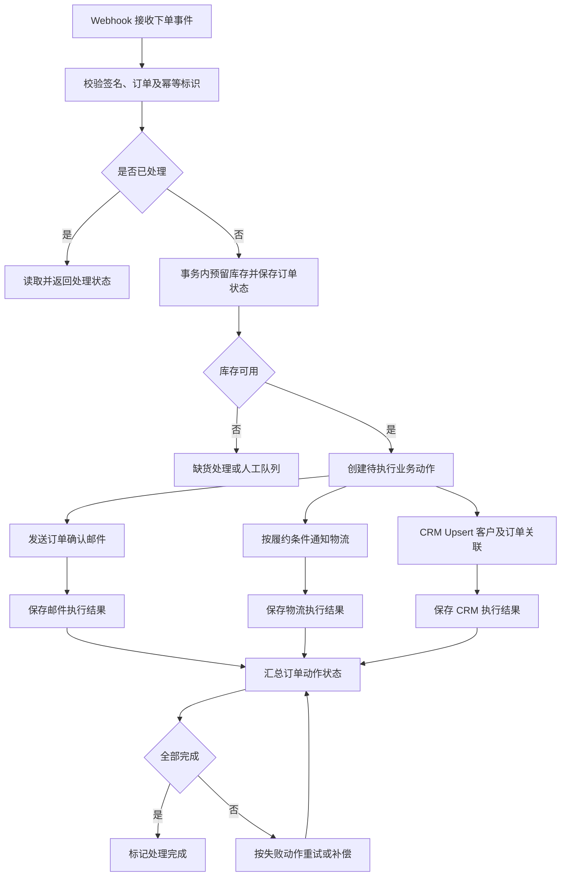

# Task5 · 第五章习题解答

按第五章七道习题逐项作答。平台能力依据 2026 年 11 月 26 日查阅的官方资料，方案描述配合[操作与运行记录](learning-notes.md)核对。题目中关于 Coze MCP 的旧前提在第 2 题更新。[课程习题原文][exercises]

## 1. 四个平台与三种开发模式

| 平台 | 核心定位 | 解决的主要问题 |
| --- | --- | --- |
| Coze | 可视化构建智能体、工作流和应用，连接插件与发布渠道。 | 产品人员能较快组织提示、工具和界面，验证应用是否满足用户需求。[官方项目][coze] |
| Dify | 以模型、工作流、知识库和插件构建 LLM 应用，提供自托管路径。 | 将检索、路由、生成和应用接口放进可调试的编排中，支持团队从原型走向部署。[官方项目][dify] |
| FastGPT | 侧重知识库处理、检索问答和可视化 AI 工作流。 | 减少私有知识问答中资料处理与检索编排的重复工作。[官方项目][fastgpt] |
| n8n | 以触发器、连接器、条件和执行节点组织跨系统自动化，可接入模型与 Agent。 | 把邮件、数据库、CRM、外部 API 和 AI 处理串成可执行流程。[官方 HTTP 节点][http] |

**低代码模式**适合已有节点足以覆盖需求、需要快速试验和观察数据流的业务，例如内部资料问答或邮件分类。**纯代码模式**适合核心算法、复杂状态一致性、性能或定制测试要求较高的服务，例如高并发订单履约。**混合开发**可用平台编排输入、路由和通知，用代码服务负责核心规则与数据接口，例如文档工作流调用内部合同条款比对服务。选择时要一起核算平台运行、模型、存储和维护成本。[第五章平台化构建][chapter]

## 2. 每日 AI 简报的定时、提示与 MCP

### 每天 8 点自动生成并送达

设计流程为「定时触发 → 收集过去 24 小时资料 → 去重和筛选 → 生成简报 → 校验来源与格式 → 投递并保存状态」。设定时区 `Asia/Shanghai`，每天 08:00 执行，使用日期、目标群和简报版本组成发送幂等标识。失败时保留已生成内容，重试投递，避免重复生成并多次发送。

目前 Coze 官方文档说明，功能升级期间暂不支持为低代码智能体新增触发器，既有触发器仍可使用，低代码应用的定时触发节点则有独立说明。可用的替代设计是 n8n Schedule Trigger 按上述时间调用已发布的 Coze 工作流 API，取得结果后经 HTTP Request 向飞书群机器人投递。Schedule 工作流需要保存并发布才能按时运行，界面的状态名称以部署版本为准。[Coze 触发器说明][coze-triggers] · [应用定时触发节点][coze-app-trigger] · [n8n 定时触发器][schedule]

飞书自定义机器人需要已配置的群 Webhook，以及对应的签名或其他安全设置。工作流检查投递响应，再更新发送记录。微信公众号属于另一条渠道接入，认证、消息类型和发布能力需按目标账号配置。本题选择飞书作为定时方案的目标渠道。[飞书官方机器人说明][feishu]

### 优化简报提示

下面的提示将证据、信息时间和分析分开，允许资料不足时减少条目。

```text
你为 AI 技术读者整理每日简报。
使用传入资料，标注简报日期、时区和资料截止时间。
将内容分为技术新闻、论文、开源项目，每类最多三条。
每条包含标题、发生时间、已核实事实、原始来源链接和一句影响说明。
相同事件合并，保留原始公告或论文，信息不足时明确标注。
热点分析写出支持证据和影响对象。
趋势部分用“可能”“条件”“待观察指标”表达推断。
按重要性排序，避免把宣传语、摘要推断和未经核对的数字写成事实。
```

可用同一份固定资料比较优化前后的重复率、有效来源比例、时间窗符合率、字段完整率及事实支持率。真实新闻随时间变化，提示效果需要结合保留的输入与输出评估。

### MCP 是什么，Coze 支持后意味着什么

MCP 是开放的模型上下文协议，用统一的客户端与服务端接口提供工具、资源和提示等能力。它把服务发现、能力描述和调用交换规范化，使一份服务实现更容易被多个 AI 应用复用。[MCP 官方架构][mcp]

题目提到的「Coze 不支持 MCP」属于旧版本背景。当前官方文档已说明，扣子编程内置 MCP 客户端，可基于已有 MCP 服务创建插件供低代码智能体和工作流调用。当前扣子 MCP 文档列出 Streamable HTTP、SSE 的接入，具体产品与部署版本仍需分别核对。新增能力可以用于接入企业知识库、地图和内部业务工具，并复用服务端的参数契约。[基于 MCP 服务创建插件][coze-mcp-plugin] · [扣子 MCP 文档][coze-mcp]

## 3. Dify 的路由、数据库上下文和部署

### 分类器为何有价值

分类器把请求分配给范围明确的处理分支。例如，文案分支使用写作提示和输出格式，数据查询分支使用数据库工具与查询规则。各分支可以独立选择模型、知识库、工具和测试集，出错时也便于定位。单个处理器装入所有任务说明和工具，会增加上下文成本，任务约束可能互相干扰，工具选择也更难验证。

分类器本身可能误路由。应为类别定义边界与典型示例，对包含多个意图的请求拆分或澄清，并保留兜底路径。按类别检查路由正确率、最终完成率和失败原因，比单看分类准确率更能反映用户体验。[Dify 问题分类器][classifier]

### 50 张表、每表 20 个字段怎样选上下文

先建立元数据目录，保存表的业务含义、字段说明、单位、枚举、主外键和权限。接收问题后，按业务域与权限筛选，再检索相关表与列。沿关联键补充必要的连接关系，只把候选表的精简 DDL、所需字段和关键约束交给模型。术语存在歧义时，先查询目录或向用户澄清。

生成 SQL 后，检查允许的表与列、关联条件、只读约束、返回规模和查询超时。执行错误可以带回具体的字段或类型信息，用有限次数修正。目录按数据库版本更新，预先用跨表问题评估检索召回率，防止缩短上下文时丢掉关键关联。本段为架构设计。[课程数据查询案例][dify-case]

### 本地与云端

| 维度 | 自托管 | 云端服务 |
| --- | --- | --- |
| 数据边界 | 可在企业网络部署，但还要检查模型、嵌入、OCR、插件和日志的实际数据流向。 | 需核对服务商的数据处理、区域、留存及企业授权要求。 |
| 成本 | 支付机器、存储、模型推理和运维成本，按利用率核算。 | 按服务、用量及模型调用计费，降低最初的部署负担。 |
| 性能 | 可以按负载调配队列、模型和数据库，容量规划由团队负责。 | 使用已提供的配额和扩容能力，验证并发、限流和端到端延迟。 |
| 维护 | 负责升级、插件兼容、备份恢复和监测。 | 平台维护由服务商承担，应用版本和数据质量仍由团队管理。 |

快速验证且允许云端处理的应用可先用云服务。明确要求资料留在客户内网时，应评测包括模型和依赖服务在内的私有部署方案。[Dify 自托管文档][dify-selfhost]

## 4. n8n 的持久化、附件和电商流程

### 替换内存存储的配置与验证

知识文档和聊天记录分别存储。本次采用 Qdrant 存知识向量、Redis 存聊天记录。官方文档明确说明，Simple Vector Store 的数据存于应用内存，重启后丢失。[Simple Vector Store][simple-vector]

已准备的本地环境为 Node 24.22.3、n8n 2.49.7、Qdrant 1.20.2 和 Redis 7.4.11。Qdrant 使用专用存储目录，地址为 `127.0.0.1:6335`，Redis 在 `127.0.0.1:6385` 启用 AOF。知识导入脚本已将 3 条课程资料通过本机 `nomic-embed-text` 编码为 768 维向量，写入 `hello_agents_task5` 集合。[索引记录](knowledge-index.json) · [知识导入代码](../../code/chapter5/prepare-knowledge.py)

平台界面启动的执行编号 3 已成功，真实调用 Task5_Knowledge 返回这 3 条资料，再调用 Calculator 得到 38069.25。n8n、Redis、Qdrant 优雅重启后，两个会话的历史数量与各自内容校验值一致，知识集合仍保留 3 个向量点。执行编号 4 的输入省略姓名，模型回忆出先前的「林同学」，并再次通过 Qdrant 查询四个平台。[工作流](../../code/chapter5/task5-agent.json) · [实际执行](execution.json) · [重启与回忆验证](persistence-check.json) · [平台截图](n8n-platform-run.jpg)

本次检索元数据带有来源，最终回复仍省略了 URL。后续若将来源展示设为验收条件，需要增加输出字段和引用检查。[实际回答与来源元数据](execution.json)

本次配置与可复用的验收步骤如下。

1. 在 n8n 的 Credentials 中配置 Qdrant、Redis 和 Ollama 连接，使用本任务的专用服务与数据范围。
2. 导入和检索使用同一集合、嵌入模型、版本和向量维度。为知识记录保留稳定文档 ID、来源及版本，更新时使用同一 ID 管理去重。
3. 将 Qdrant Vector Store 配为 Retrieve Documents (As Tool for AI Agent)，连接 Agent 的 Tools。明确工具名称、说明和返回条数，Embeddings 连接 Ollama 的同一嵌入模型。正式多用户场景按认证身份过滤资料范围。
4. 将 Redis Chat Memory 连接到 Agent 的 Memory，配置 Session Key、会话 TTL 和上下文窗口。生产 Session Key 应组合组织、用户和邮件线程，减少不同会话串用记录的可能。
5. 写入资料和聊天记录后重启 n8n、Qdrant 和 Redis，比较数量和内容校验值，再执行省略姓名的回忆请求。本次已完成优雅重启、历史一致性和回忆验证。正式多用户场景还应增加跨用户隔离用例。

Redis 的 AOF、RDB 和磁盘目录决定重启后的数据恢复策略。TTL 决定记录何时过期，上下文窗口决定本次传给模型的历史范围。这些配置需要分别核对。[Qdrant 节点][qdrant] · [Ollama 嵌入节点][ollama-embeddings] · [Redis Chat Memory][redis-memory] · [Redis 持久化][redis-persistence]

若采用 PostgreSQL，也可以组合 PGVector Vector Store 和 Postgres Chat Memory，分别配置向量集合与会话表，遵循相同的模型一致性和重启验收原则。[PGVector 节点][pgvector] · [Postgres Chat Memory][pg-memory]

### 邮件附件扩展

Gmail 触发后读取完整邮件并下载附件，将附件二进制字段传给后续节点。按实际文件类型分流。文本型 PDF 用 Extract From File 提取内容，扫描 PDF 和图片经 OCR 或视觉模型分析，保留文件名、页码及来源消息。分块检索后，与邮件正文和会话上下文一起回答。对损坏、加密、超大或解析失败的附件形成清晰状态，回复时说明哪些资料已成功读取。[n8n 文件提取节点][extract-file]

### 电商下单后的节点连接图

以下是待实现的工作流设计。示例把订单状态和库存预留放在同一数据服务内，邮件、物流和 CRM 分别保存外部操作状态。

一个 n8n 工作流可以包含多个触发节点，每次执行由其中一个触发事件启动。测试可以增加手动触发，正式订单入口使用 Webhook，再接到共用的处理节点。[n8n 官方节点类型说明][node-types]



| 节点 | 关键配置 |
| --- | --- |
| Webhook 与校验 | 核验事件签名及订单状态，使用平台事件 ID 和订单 ID 去重，校验数量与必需字段。 |
| 库存服务或数据库 | 原子检查可用库存并预留，预留与订单记录在同一事务内完成。网络超时后先查处理状态。 |
| 待执行动作与重试 | 用唯一动作 ID 记录待办和结果，设置重试次数、退避和人工处理出口，避免某项失败后重放全部动作。 |
| 确认邮件 | 主题、收件人和正文来自已核验订单，保存发送请求 ID，避免重复确认。 |
| 物流接口 | 按业务履约条件调用，提供订单和必要配送信息，保存运单或请求状态。 |
| CRM | 按稳定客户标识 Upsert，并建立订单关系，重复事件更新同一记录。 |
| 汇总与异常 | 从持久状态判断各动作是否完成，保留错误和补偿记录，超过预算转人工处理。 |

HTTP Request 可以直接接入没有预置节点的业务 API。节点画布提供编排，事务、幂等和跨系统补偿由对应服务与执行状态共同保证。[n8n HTTP Request][http]

## 5. 提示设计与 500 字要求

| 案例 | 结构与侧重 |
| --- | --- |
| Coze AI 简报 | 面向内容编辑，按资料源收集新闻、论文和项目，强调模块、条目和原始链接。 |
| Dify 个人助手 | 先路由再使用专门模块，分别规定角色、任务边界、输入及输出。文案与数据查询需要不同约束。 |
| n8n 邮件助手 | 提示包含来信、时间、工作安排及工具，生成可被下游节点使用的字段，并处理非工作时间提醒。 |

这些差异首先由任务和后续执行要求决定。平台提供变量、节点和工具接口，设计者据此把内容要求转为能够连接的输入输出。邮件流程还应把生成 JSON 解析并校验后，再将正文映射给邮件节点。[Coze 案例][coze-case] · [Dify 案例][dify-case] · [n8n 案例][n8n-case]

统一要求优化稿超过 500 字，可能把短通知、标题和按钮文案扩写得冗长，原文信息不足时也容易引入推测。应先确定受众、用途和媒介。标题、短信、摘要、表单字段及明确的版面限制适合设置上限或范围，并由程序计数。长文创意探索、初稿和深度说明可以给更宽的长度范围，再依据完整性、可读性及用户反馈修订。[课程文案优化提示][dify-case]

## 6. 自定义工具、MCP 与 Dify 插件

### 平台没有所需工具怎么办

对已有内部 REST API，可以使用平台的 HTTP 节点、导入接口说明或开发工具插件。多个应用都要复用同一能力时，可以把它封装成 MCP 服务，由各支持客户端接入。涉及复杂事务、长任务或已有核心业务逻辑时，在服务端实现并通过稳定接口调用。Coze、Dify、FastGPT 和 n8n 都应按具体版本核对接入方式，接口的身份、权限、超时、返回类型和重试语义需要清楚定义。[n8n HTTP 节点][http] · [Dify HTTP 节点][dify-http] · [Coze MCP 插件][coze-mcp-plugin]

### MCP、REST 与 Tool Calling

| 概念 | 解决的问题 | 与其他机制怎样组合 |
| --- | --- | --- |
| RESTful API | 用资源、表示和统一接口等约束组织网络服务。 | 业务服务可以继续提供 REST 接口，再由工具适配层调用。[Fielding 原文][rest] |
| Tool Calling | 模型依据工具说明产生结构化名称与参数，由应用或托管执行器执行并回填结果。 | 应用可把所选调用映射到本地函数、REST 请求或 MCP 工具。[官方工具调用说明][tool-calling] |
| MCP | 统一 AI 应用与能力提供端之间的发现、能力描述和调用交换，覆盖工具、资源及提示等。 | MCP 服务内部可调用 REST API，客户端再把可用工具暴露给模型选择。[MCP 官方架构][mcp] |

称 MCP 为新标准，是因为它提供跨客户端和服务端的共同契约，减少逐对定制集成。实际使用仍要匹配协议版本、传输和授权，评估工具说明与结果。平台采用 MCP 以后，权限控制和业务正确性仍由应用及服务实现。[MCP 官方架构][mcp]

### Dify 内部知识库插件开发概要

可以开发只读的 `internal_kb_search` 工具，输入查询和允许的知识域，输出带来源、版本和片段标识的检索结果。以下按当前官方 Tool Plugin 文档概述开发流程。

1. 在独立插件项目中准备文档要求的 Python 3.12 和 Dify Plugin CLI，用 `dify plugin init` 选择 Tool 模板。
2. 在 `manifest.yaml` 声明插件标识、版本、运行配置、能力和资源。Provider 配置定义凭证，Tool 配置定义 query 等参数及清晰的使用说明。
3. 在 Provider 的 `_validate_credentials` 中核对服务地址与凭证是否可用，采用只读验证接口。凭证交由运行时提供。
4. 在 Tool 的 `_invoke` 中调用内部检索 API，设置超时，处理空结果及错误，校验并裁剪返回字段，用 `create_json_message` 或相应消息类型返回证据。
5. 配置目标 Dify 的调试连接，用 `python -m main` 运行调试。检验合法与无效凭证、权限隔离、空结果、超时和中文查询。
6. 验证后用 `dify plugin package ./插件目录` 生成 `.difypkg`，在目标实例安装，确认版本兼容后接入工作流，并保留回滚版本。

内网方案还需确认 Dify、插件运行器及知识库服务之间可达，并把调用身份与知识权限绑定。以上是插件开发设计。[Dify Tool Plugin 开发文档][dify-plugin] · [官方完整开发示例][dify-plugin-walkthrough]

## 7. 三个应用的平台选型

### A · AI 写作助手小程序

我选择 Coze 做首轮产品验证，用现有模型、写作工作流和 API 支撑小程序界面。前端工程师负责用户输入、内容展示及调用集成，产品经理维护写作场景和验证样本。上线前核对所选账号、地区及小程序渠道支持，优先交付少量高频写作功能。[Coze API 概览][coze-api]

| 维度 | 选择理由与需要验证的事项 |
| --- | --- |
| 技术可行性 | 通过应用 API 接入小程序，验证内容质量、身份校验和端到端错误处理。 |
| 开发效率 | 提示和流程可视化调整，前端接入接口，先验证少数高频写作场景。 |
| 成本 | 以调用量和输入输出长度估算平台及模型费用，为单次生成设置预算。 |
| 维护 | 导出或记录可导出的配置、接口版本和回归样本，测试发布前后的行为。 |
| 扩展 | 达到验证目标后，可将核心写作逻辑拆为代码服务，逐步接入素材检索和内容管理。 |
| 数据 | 明确用户文本的传输与存储，避免把产品账号能访问的其他资料自动带入写作上下文。 |

### B · 私有环境中的合同审核

我选择自托管 Dify 编排，加上私有模型、文档解析、知识检索和代码实现的业务校验。OA 与文档管理系统通过内网接口接入，保留文件版本、身份和访问权限，输出供业务人员复核的条款证据及修改建议。[Dify 自托管文档][dify-selfhost]

| 维度 | 选择理由与需要验证的事项 |
| --- | --- |
| 技术可行性 | 在内网连接文档提取、条款检索、模型评审与人工复核，验证 OA 及文档接口。 |
| 开发效率 | 先验证少数合同类型，再扩展资料和规则，平台承担流程编排。 |
| 成本 | 核算私有推理、存储、解析和运维开销，比较部署规格与业务负载。 |
| 维护 | 维护模型、插件、政策资料和流程版本，保留有人工标注的回归样本。 |
| 扩展 | 复杂规则、合同差异和 OA 状态变更可由专门服务承接。 |
| 数据 | 核查模型、嵌入、OCR、插件、遥测与备份均符合内网边界，建立访问控制及审计。 |

这里分析系统选型与证据流程，实际合同判断需要业务专业人员明确审核规则和责任边界。

### C · 研发效能自动化

我选择 n8n 编排，加上团队代码服务处理代码分析和受控测试。仓库事件触发审查任务，测试结果进入报告流程，问题与项目状态通过 API 同步。技术较强的团队可以把复杂且频繁变化的分析保留在代码仓库中。[n8n HTTP Request][http]

| 维度 | 选择理由与需要验证的事项 |
| --- | --- |
| 技术可行性 | 节点连接代码仓库、CI、Bug 跟踪和项目系统，代码服务处理专门分析。 |
| 开发效率 | 先把事件到结果的最短链路跑通，再复用节点和子工作流扩展。 |
| 成本 | 控制模型调用、测试资源和自动化执行频率，按事件去重。 |
| 维护 | 工作流导出纳入版本管理，核心逻辑按正常代码评审流程修改，用真实回归事件测试。 |
| 扩展 | 按任务类型拆分子工作流，必要时增加队列和独立 worker，并测试容量。 |
| 数据 | 最小化仓库及工单权限，隔离测试执行环境，检查日志和报告中的敏感数据。 |

[exercises]: https://github.com/datawhalechina/hello-agents/blob/main/docs/chapter5/第五章%20基于低代码平台的智能体搭建.md#习题
[chapter]: https://github.com/datawhalechina/hello-agents/blob/main/docs/chapter5/第五章%20基于低代码平台的智能体搭建.md
[coze-case]: https://github.com/datawhalechina/hello-agents/blob/main/docs/chapter5/第五章%20基于低代码平台的智能体搭建.md#522-构建每日ai简报助手
[dify-case]: https://github.com/datawhalechina/hello-agents/blob/main/docs/chapter5/第五章%20基于低代码平台的智能体搭建.md#532-构建一个超级智能体个人助手
[n8n-case]: https://github.com/datawhalechina/hello-agents/blob/main/docs/chapter5/第五章%20基于低代码平台的智能体搭建.md#554-创建-agent-主工作流
[coze]: https://github.com/coze-dev/coze-studio
[dify]: https://github.com/langgenius/dify
[fastgpt]: https://github.com/labring/FastGPT
[coze-api]: https://www.coze.com/open/docs/developer_guides/coze_api_overview
[coze-triggers]: https://docs.coze.cn/guides_task
[coze-app-trigger]: https://docs.coze.cn/guides_set_timed_trigger
[coze-mcp-plugin]: https://docs.coze.cn/guides_create_a_plugin_based_on_mcp
[coze-mcp]: https://docs.coze.cn/mcp
[schedule]: https://docs.n8n.io/integrations/builtin/core-nodes/n8n-nodes-base.scheduletrigger/
[feishu]: https://open.feishu.cn/document/client-docs/bot-v3/add-custom-bot?lang=zh-CN
[classifier]: https://docs.dify.ai/en/use-dify/nodes/question-classifier
[dify-selfhost]: https://docs.dify.ai/en/self-host/deploy/quick-start/docker-compose
[simple-vector]: https://docs.n8n.io/integrations/builtin/cluster-nodes/root-nodes/n8n-nodes-langchain.vectorstoreinmemory/
[pgvector]: https://docs.n8n.io/integrations/builtin/cluster-nodes/root-nodes/n8n-nodes-langchain.vectorstorepgvector/
[pg-memory]: https://docs.n8n.io/integrations/builtin/cluster-nodes/sub-nodes/n8n-nodes-langchain.memorypostgreschat/
[qdrant]: https://docs.n8n.io/integrations/builtin/cluster-nodes/root-nodes/n8n-nodes-langchain.vectorstoreqdrant/
[ollama-embeddings]: https://docs.n8n.io/integrations/builtin/cluster-nodes/sub-nodes/n8n-nodes-langchain.embeddingsollama/
[node-types]: https://github.com/n8n-io/n8n-docs/blob/main/docs/connect/create-nodes/plan-your-node/choose-a-node-type.md
[redis-memory]: https://docs.n8n.io/integrations/builtin/cluster-nodes/sub-nodes/n8n-nodes-langchain.memoryredischat/
[redis-persistence]: https://redis.io/docs/latest/operate/oss_and_stack/management/persistence/
[extract-file]: https://docs.n8n.io/integrations/builtin/core-nodes/n8n-nodes-base.extractfromfile/
[http]: https://docs.n8n.io/integrations/builtin/core-nodes/n8n-nodes-base.httprequest/
[dify-http]: https://docs.dify.ai/en/use-dify/nodes/http-request
[mcp]: https://modelcontextprotocol.io/docs/learn/architecture
[rest]: https://ics.uci.edu/~fielding/pubs/dissertation/rest_arch_style.htm
[tool-calling]: https://platform.claude.com/docs/en/agents-and-tools/tool-use/overview
[dify-plugin]: https://docs.dify.ai/en/develop-plugin/dev-guides-and-walkthroughs/tool-plugin
[dify-plugin-walkthrough]: https://docs.dify.ai/en/develop-plugin/dev-guides-and-walkthroughs/develop-flomo-plugin
