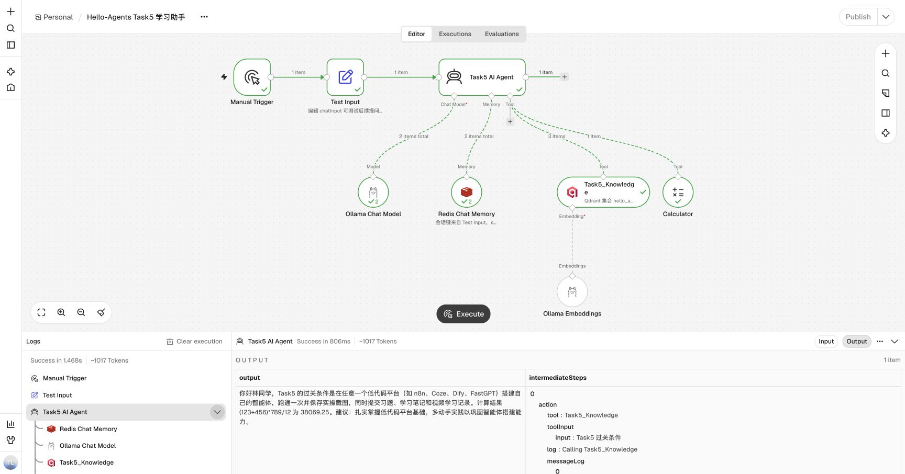

# Task5 学习笔记 · 低代码平台与本地 n8n 实操

2026 年 11 月 26 日，本次以 n8n 搭建课程学习助手，完成界面真实运行、知识检索、计算器调用，以及 n8n、Redis、Qdrant 优雅重启后的数据与会话回忆验证。

## 课程阅读与案例理解

第五章介绍 Coze、Dify、FastGPT 和 n8n。Coze 案例把新闻、论文和开源项目汇成简报；Dify 用问题分类器路由到专门模块；FastGPT 展示文档检索问答；n8n 将触发器、模型、记忆和工具接成工作流。阅读时，我关注每个节点的输入字段、输出格式和下游依赖。[第五章课程原文][chapter]

课程邮件案例帮助区分了三种数据。知识库提供待检索资料，会话记忆保存先前对话，工作流运行记录说明节点实际执行了什么。答复里出现正确数字，还需要回到运行记录查看是否使用了计算器。回答引用知识，也需要核对实际召回片段是否支持结论。

当前文档有两处版本变化值得记录。扣子已经提供 MCP 接入，课程关于不支持 MCP 的判断应放回旧版本背景。n8n 一个工作流可以有多个触发节点，每次执行由其中一个事件启动。[扣子 MCP 文档][coze-mcp] · [n8n 官方节点类型说明][node-types]

## 视频学习记录

本次核看社区 EP5 的关键帧及烧录字幕，以下时间范围对应实际观察的片段。[社区逐章视频 EP5](https://www.youtube.com/watch?v=_YEUPvl4vjw)

| 片段范围 | 观察内容 | 对实操的帮助 |
| --- | --- | --- |
| 03:05–03:35 | Coze 简报的数据输入与汇总流程 | 先确认资料源及字段，再检查生成结果的链接和条目。 |
| 04:45–05:10 | Dify 的问题分类与分支路由 | 对照问题意图、分类结果和后续模块的输入。 |
| 07:25–07:35 | n8n 邮件助手整体流程 | 识别触发、Agent 处理和输出之间的连接。 |
| 07:35–08:00 | 模型、记忆和工具等子节点 | 按连接类型确认节点承担的职责。 |
| 08:00–08:10 | 内存存储的说明 | 为后续 Redis 与 Qdrant 持久化练习确定检查点。 |

官方小红书视频入口本次未能读取。随后补充核看覆盖整段 10 分 24 秒时间轴的 126 张公开预览图，以及两处高清画面；音轨未经核对。[完整时间轴的画面学习记录](video-study.md)说明了观察方法与范围。

## 本地环境

| 组件 | 本次配置 |
| --- | --- |
| 系统与 Python | macOS arm64，使用项目已有 Python 3.11.17 虚拟环境。 |
| Node 与 n8n | 项目隔离安装 Node 24.22.3、n8n 2.49.7，[打开本地编辑器](http://localhost:5685)。 |
| 生成模型 | 复用本机 Ollama 的 qwen3.5:4b。 |
| 向量模型 | 本机 nomic-embed-text，实际输出 768 维。 |
| Qdrant | 1.20.2，[任务专用服务](http://127.0.0.1:6335)，知识集合 hello_agents_task5。 |
| Redis | 7.4.11，任务专用端口 6385，启用 AOF。 |

版本与本机运行路径保存在[版本记录](../../code/chapter5/runtime-versions.json)。n8n、Redis、Qdrant 的本地数据和连接配置由本机运行目录保存，分享的工作流在另一台机器导入时需要重新准备服务并绑定 Credentials。

## 搭建过程

1. 检查 n8n 的 Node 版本要求，在项目专用目录准备 Node 24 和 n8n，复用已有 Python 与 Ollama。安装后核查 SQLite 等原生模块能否加载。
2. 启动任务专用 Redis 与 Qdrant，分别设置磁盘存储位置和本地端口。启动 n8n，初始化本地工作区并配置模型、Redis、Qdrant 的连接。
3. 准备 3 条课程知识资料，保留稳定文档 ID 和来源。导入脚本通过 Ollama 生成向量，再按稳定 ID 写入 Qdrant。索引记录包含集合、模型、维度与文档数量。
4. 在画布上连接 Manual Trigger、Test Input 和 Task5 AI Agent。将 Ollama Chat Model 接到模型端口，Redis Chat Memory 接到记忆端口，Task5_Knowledge 与 Calculator 接到工具端口。
5. 在 Task5_Knowledge 下连接 Ollama Embeddings，保持查询端与导入端使用同一嵌入模型。检索集合设为 hello_agents_task5，返回上限为 3，并带回来源元数据。
6. Redis 会话键从 Test Input 的 sessionId 读取，上下文窗口设为 6。本次演示设置 sessionTTL 为 0，并通过重启前后的实际记录与回忆测试核验保留效果。

[知识资料](../../code/chapter5/knowledge.json) · [导入脚本](../../code/chapter5/prepare-knowledge.py) · [索引结果](knowledge-index.json) · [工作流文件](../../code/chapter5/task5-agent.json)

在已经准备好本机二进制与配置的项目目录，可以用以下命令复用服务并检查状态。启动脚本读取现有本地配置，初始化新机器还需按版本记录准备依赖、凭证和持久数据目录。

```bash
cd /Users/xintianyuan/project/hello-agents
.venv/bin/python code/chapter5/start-services.py
.venv/bin/python code/chapter5/start-services.py --status
.venv/bin/python code/chapter5/prepare-knowledge.py
```

[服务启动脚本](../../code/chapter5/start-services.py) · [n8n Qdrant 节点][qdrant] · [Redis Chat Memory][redis-memory]

## 实际平台执行与工具验证

测试输入由本地 Set 节点提供，要求记住「林同学」这一称呼，检索 Task5 过关条件，调用计算器求解 `(123+456)*789/12`，最后给出一句学习建议。

2026 年 11 月 26 日 17:45:00，通过 n8n 平台界面手动启动执行编号 3，约 1.5 秒后状态为 success。运行轨迹中有两项实际工具调用。[执行导出](execution.json)

| 顺序 | 工具与输入 | 实际观察 |
| --- | --- | --- |
| 1 | Task5_Knowledge，查询「Task5 过关条件」 | 返回 3 条已写入的课程资料，含 doc_id 与来源。 |
| 2 | Calculator，输入 (123+456)*789/12 | 返回 38069.25。 |

Agent 最终答复称呼「林同学」，概括过关条件并给出计算结果 38069.25。这里的输入是本地合成测试，输出用于验证学习助手的工具与状态链路。



[查看平台实操截图](n8n-platform-run.jpg)

## 优雅重启与会话回忆

向本任务的 n8n、Redis、Qdrant 进程发送 SIGTERM，随后使用启动脚本重新启动三个服务。重启前后，两个 Redis 会话分别保留 6 条和 8 条消息，每个会话内容的 SHA-256 一致。Qdrant 集合仍有 3 个向量点，记录的校验值一致。[重启前后检查](persistence-check.json)

重启后的执行编号 4 使用 `task5-persistence-20261126` 会话键。新输入只询问先前称呼，并要求查询第五章四个平台，未提供「林同学」这一名称。模型从会话记录回忆出「林同学」，实际调用 Task5_Knowledge 后列出 Coze、Dify、FastGPT 和 n8n。[回忆验证工作流](../../code/chapter5/persistence-recall.json) · [执行 4 的输入、输出与工具轨迹](persistence-check.json)

复现回忆实验时，先把主工作流 Test Input 的 `sessionId` 改为 `task5-persistence-20261126` 并执行带称呼的输入，再重启服务，运行回忆工作流。两个工作流必须使用相同会话键。平台截图使用独立的 `task5-ui-20261126` 会话，以保留一轮清晰的工具调用记录。

| 检查项 | 实际结果 |
| --- | --- |
| 界面实操和截图 | 执行 3 使用新会话 task5-ui-20261126，完成两项工具调用并保存平台截图。 |
| Redis 重启前后数据 | 两个会话的消息数量与各自内容校验值一致。 |
| Qdrant 重启前后数据 | 集合保留 3 个向量点，数据校验值一致，执行 4 再次检索成功。 |
| n8n 重启后重新执行 | 执行 4 状态 success，输入省略姓名仍回忆出原称呼。 |
| 对外投递与每日定时 | 习题设计方案，当前实操采用本地输入与结果展示。 |

验证完成后，三个任务服务的健康检查通过，监听地址均为本机回环地址。项目的 `pip check` 通过。[环境检查记录](environment-check.json)

## 踩坑与处理

| 现象或问题 | 处理与心得 |
| --- | --- |
| 同一会话重复提问时，Agent 可能直接使用历史答案 | 界面第 2 次运行出现了这种行为。要观察真实工具调用，使用新的 sessionId，并查看本轮 intermediateSteps 和工具节点记录。 |
| 最终答复正确，但本轮工具记录为空 | 分别核对记忆来源和本次工具轨迹。答案正确性、真实调用和会话回忆需要独立验收。 |
| 检索元数据有 source，最终回答仍省略来源 URL | 本次执行出现了这个问题。提示中要求附来源，仍需另查输出是否满足。可在后续工作流增加结构化引用字段和来源校验，并保留可回溯的检索记录。 |
| 嵌入模型或向量维度不一致 | 导入与查询固定同一个模型，并在创建集合前检查实际维度。本次索引为 768 维。 |
| 把内存节点换成外部服务后就认为完成持久化 | 本次核查 AOF 和磁盘存储，再优雅重启三个服务，对照记录与回忆。检索成功和会话恢复各自保留证据。[Redis 持久化说明][redis-persistence] |
| Qdrant 刚关闭 HTTP 端口，重启却报 WAL WouldBlock | 端口关闭时旧进程可能还在释放磁盘锁。等待旧 Qdrant 进程完全退出后再启动，随后恢复健康。启动脚本把工作目录放在任务数据目录，运行标记也留在 Git 忽略范围内。 |
| 工作流导入后缺少连接或无法访问本地服务 | 按版本记录准备运行环境，重新绑定本机 Credentials，再检查服务健康状态。 |
| 浏览器登录与本地访问地址不一致 | 本次保留安全 Cookie 设置，浏览器通过 [localhost 编辑器地址](http://localhost:5685)访问。后台服务监听本机回环地址。 |
| 画布连线看起来相同，职责却不同 | 区分主数据流与 ai_languageModel、ai_memory、ai_tool、ai_embedding 连接，检查各子节点实际接到了哪个端口。 |

本次实操让我把前面章节的「模型决策、工具返回、状态延续」对应到了 n8n 的节点与执行记录。后续把同样方法用于仿真或轨迹任务时，可以让工具返回场景标识、运行状态和可核对的数值，再由模型组织解释。

[习题解答](exercises.md) · [学习心得](reflections.md) · [课程内容反馈](course-feedback.md)

[chapter]: https://github.com/datawhalechina/hello-agents/blob/2eb1c7547018b519b85cb57acf5533f12d65bf8e/docs/chapter5/第五章%20基于低代码平台的智能体搭建.md
[coze-mcp]: https://docs.coze.cn/mcp
[node-types]: https://github.com/n8n-io/n8n-docs/blob/main/docs/connect/create-nodes/plan-your-node/choose-a-node-type.md
[qdrant]: https://docs.n8n.io/integrations/builtin/cluster-nodes/root-nodes/n8n-nodes-langchain.vectorstoreqdrant/
[redis-memory]: https://docs.n8n.io/integrations/builtin/cluster-nodes/sub-nodes/n8n-nodes-langchain.memoryredischat/
[redis-persistence]: https://redis.io/docs/latest/operate/oss_and_stack/management/persistence/
